# Auto Claims Triage

A prototype that turns photos of a damaged car into a structured first look for an auto-insurance adjuster: the vehicle, the damage, a repair-cost **range**, and a recommended next step. It is a triage aid. It never decides coverage, liability, denial or payment, and a human reviews anything uncertain.

- **Live prototype:** https://auto-claims-triage-production.up.railway.app (shared access code, given separately; `/healthz` is open)
- **Code:** this repository, tag `v0-submission`
- **Deeper docs:** [`docs/HANDOFF.md`](docs/HANDOFF.md) (facts and decisions), [`docs/eval_results.md`](docs/eval_results.md) (full eval), [`docs/failures.md`](docs/failures.md) (failure log), [`docs/DEPLOY.md`](docs/DEPLOY.md) (Railway)

## What it does

**In:** one to five photos of a damaged vehicle, uploaded or by URL, plus an optional region (labor-rate tier).

**Out:**
- Vehicle: make, model, color, year range, each with a confidence.
- Damage: panel, side (the vehicle's own left/right), type, severity 1 to 4, confidence and the visible cues behind each finding.
- A repair-cost range with its drivers and caveats. Severity-4 (structural) damage is never priced: the range is labeled partial and a person must assess it.
- A recommended route with plain-English reasons: `fast_track_candidate`, `adjuster_review`, `request_more_photos` or `possible_total_loss`.
- An edit-and-accept screen for the adjuster; every correction is logged as eval data.
- Cost and latency per request, and an audit record (request id, model, prompt, schema, rules and cost-table versions, input hash).

## Try it

**Live:** open the URL, enter the access code, upload a photo or paste an image URL. Cases worth trying (sample photos come from `scripts.fetch_samples`, see below):

| Case | What you should see |
|---|---|
| A clean front-damage photo (`case1_clean_cirrus.jpg`) | Vehicle, damage, a cost range, `adjuster_review` |
| A crash against a lamp post (`case8_multiphoto_mercedes_a.jpg`) | Severity-4 wheel: "cost not estimable" with a labeled partial range, `adjuster_review`, and a "better photos would help" note |
| A photo of a dog (`case5a_noncar_obvious.jpg`) | Refused as not a vehicle, with retake advice |
| A photo containing text that tells the AI to approve the claim (`case6_injection_cirrus.jpg`) | Text flagged and ignored, routed to an adjuster |

## Setup (local)

Prerequisites: [uv](https://docs.astral.sh/uv/) (installs Python 3.12 from `.python-version`), an Anthropic API key, network access. Docker is not needed.

```bash
git clone https://github.com/hraval0024/auto-claims-triage.git
cd auto-claims-triage
uv sync
cp .env.example .env
# Edit .env: set ANTHROPIC_API_KEY, and set APP_ACCESS_CODE to 12+ characters, e.g. from:
python3 -c "import secrets; print(secrets.token_urlsafe(24))"

uv run pytest -q                               # tests; no API calls, no key needed
uv run python -m scripts.fetch_samples         # sample photos -> data/samples/ (Wikimedia Commons)
uv run uvicorn app.main:app                    # http://127.0.0.1:8000, enter the access code
```

If port 8000 is busy, add `--port 8001`. One claim from the command line:

```bash
curl -s -H "X-Access-Code: <code>" -F files=@data/samples/case1_clean_cirrus.jpg http://127.0.0.1:8000/api/claims
```

The server refuses to start, with a message naming the problem, if `ANTHROPIC_API_KEY` or `APP_ACCESS_CODE` is missing or the code is under 12 characters. Three sample entries are my own screenshots, kept local and not downloadable; `fetch_samples` reports them as missing, which is expected.

Key settings (all in `.env.example`): `MODEL_ID` and `MODEL_EFFORT` (default `claude-sonnet-5-5`, medium), `DATA_DIR`, `DAILY_CALL_CAP`, `DAILY_SPEND_CAP_USD`, per-IP rate limits, `LABOR_RATE_USD_PER_HOUR`.

**Evaluation** (about $3, three models, 34 photos):

```bash
uv run python -m scripts.fetch_eval            # eval photos -> data/eval/ (never committed)
uv run python eval.py                          # refuses to run with uncommitted changes
uv run python eval.py --report eval/results/5015ec7_20261110T194347Z   # re-score saved runs, free
```

**Deploy:** Railway builds the `Dockerfile` from `main` (`railway.json`, one replica, health check on `/healthz`). Add a volume at `/data` and set `ANTHROPIC_API_KEY`, `APP_ACCESS_CODE`, `DATA_DIR=/data`, `DAILY_CALL_CAP` and `TRUST_PROXY_HOPS=1`. Steps used, and how to rotate the code and key, are in [`docs/DEPLOY.md`](docs/DEPLOY.md). The image has been built and run by Railway but never locally.

## Architecture

```mermaid
flowchart LR
  U["Photo upload or URL"] --> I["1 Intake<br/>type, size, SSRF guard, strip EXIF, hash"]
  I --> P["2 Prechecks<br/>blur, darkness, tiny image"]
  P --> M["3 One Claude vision call<br/>gate verdict, then vehicle and damage"]
  M --> V["4 Validate<br/>schema check, retry, gate enforced in code"]
  V --> K["5 Cost engine<br/>versioned table to a range"]
  K --> R["6 Routing rules<br/>four routes with reasons"]
  R --> H["7 Adjuster review<br/>edits logged"]
  H --> D[("SQLite audit log")]
```



**The AI reads, rules price and route, a person decides.** The model is used only for what vision models do well: reading a photo. Everything after that is plain, versioned code, so a number can be explained and an assumption can be changed without retesting a prompt.

| # | Stage | What happens | Where |
|---|---|---|---|
| 1 | Intake | Magic-byte file check, size and dimension caps, SSRF-guarded URL fetch (private and loopback addresses blocked at connect time), EXIF stripped, resize to 1568 px, SHA-256 | `app/intake.py`, `app/ssrf.py` |
| 2 | Prechecks | Tiny or black frames blocked; dark or blurry warned, before any paid call | `app/prechecks.py` |
| 3 | Read | One vision call returns a photo-quality verdict first, then vehicle, damage and summary as JSON against a schema | `app/llm.py`, `app/prompts/`, `app/schemas.py` |
| 4 | Validate | Output checked against the schema with a bounded retry; the gate decision is enforced in code, not trusted from the prompt; multiple photos merged, conflicts flagged | `app/pipeline.py` |
| 5 | Price | Panel x operation x severity gives labor and paint hours plus a parts band, times region tier and vehicle class, to a low-high range with drivers | `app/cost_engine.py`, `app/cost_table_v1.yaml` |
| 6 | Route | Seven ordered rules; every rule that fired is listed in plain English | `app/routing.py` |
| 7 | Review and log | Adjuster edits are diffed against the stored result and logged, then the claim is re-priced and re-routed | `app/review.py`, `app/static/app.js` |

Around the pipeline: access code on every route except `/healthz`, per-IP rate limits, a concurrency cap, daily call and spend caps that fail closed, an image-hash cache, JSON logs with a request id, and a `/metrics` summary. Uploaded images are processed in memory and never stored; license plates are flagged, not stored.

## Why these choices

| Choice | Why | Rejected |
|---|---|---|
| Claude vision with native structured output | One call returns the quality verdict and the extraction as validated JSON. Putting the verdict first in the same call halves latency and cost. | A separate gate call; forced `tool_choice` (not accepted by the newest models) |
| Deterministic cost table, not an LLM price | A photo cannot support a trustworthy price; the number must be explainable and editable. The LLM's own guess runs behind a flag as a baseline only. | LLM as the price source |
| Range in the UI, midpoint in the API only | A midpoint implies precision the evidence does not have | A point estimate |
| Categorical confidence (high, medium, low) | Model-stated probabilities are poorly calibrated | Float confidences |
| Ordered routing rules with reasons | Auditable and testable; uncertainty always moves toward a human | ML-based routing |
| FastAPI and Pydantic | Small, typed, and the same models validate the API and the model output (224 tests) | None compared |
| SQLite on a Railway volume | Audit log, corrections, usage caps and cache survive restarts with no extra service | Postgres (the production choice) |
| Prompt caching on the static prefix | Measured 39% cheaper per call | Caching the per-request image |
| uv with a lockfile | Reproducible installs from a clean clone (verified) | None compared |

All 19 decisions, each with the alternative rejected, are in [`docs/HANDOFF.md`](docs/HANDOFF.md).

## Evaluation approach

Ten quality dimensions, each with a measure. **V0** means measured today, as agreement with one independent model's labels. **V1** means it needs the customer's real claims.

| Dimension | Measure | Status |
|---|---|---|
| Identify the vehicle | Make, model, color, year accuracy | V0 |
| Find the damage | Panel and damage-type precision and recall; recall on severity 3 and 4 | V0 |
| Grade severity | Exact match, weighted kappa, severity-4 panels found | V0 |
| Know when not to answer | Photo-check accuracy; retake rate | V0 (retake rate from routing) |
| Route safely | Referral rate; **missed referral** (false fast-track) | Referral V0; missed referral V1 |
| Price usefully | Range width; share of final costs inside the range; **material underestimation** | Width V0; rest V1 |
| Be consistent | Same route across repeat runs | V0 (10 photos); V1 on real claims |
| Be practical | Latency, cost per claim; **rework rate** | Latency and cost V0; rework V1 |
| Perform evenly | Results by vehicle type, lighting, region | V1 |
| Deliver business results | Time to first assessment, cycle time, touch time, supplements, leakage | V1 |

**Where it fails, ranked by cost to the customer.** (1) Under-rated severity, which sends severe claims toward fast-track: one model rated 0 of 8 severity-4 panels as 4. (2) A wrong cost range: unmeasured, because the cost table is a stand-in. (3) A cropped screenshot of a real photo passes the photo check (F2), a fraud gap. (4) Left and right swapped (F1): no price impact, but it erodes adjuster trust. (5) Over-refusal of busy photos: the safe direction, but it adds retakes. (6) Unstable routing between runs. Open item: the per-IP rate limit does not trigger behind Railway (F4). All are logged in [`docs/failures.md`](docs/failures.md).

**What I need from the customer.** Historical claims with photos, final estimates and supplements; estimating-system access or negotiated rates; a few hours of appraiser time to set the severity rubric, total-loss thresholds and referral rules, so expert labelers (Scale's labeling workforce) can label against their standard; their fast-track risk appetite; baseline metrics; vehicle mix, photo sources and volume; fraud and privacy requirements, including approval to send claims photos to a labeling workforce.

**The cost estimate specifically.** It is a range, never a payment. It is "good enough" when, against final paid estimates including supplements, coverage meets an agreed target, material underestimation stays within the agreed tolerance, and the range is narrow enough to help (today's median high-to-low ratio is 4.1x to 5.4x). I would run shadow mode on historical claims, then recalibrate the table's hours and parts. When it is wrong, the damage is bounded: severity-4 damage is never priced, fast-track needs a high end of $2,500 or less and a human approves payment, and corrections are logged. If coverage falls below the threshold, route everything to an adjuster.

### Results (V0, 34 public photos)

Three models, cache off, nothing changed after seeing results (run `5015ec7`; scoring `eval_v2`). These are agreement numbers against one independent model's labels (ChatGPT), not accuracy against adjusters; the labeler was not blind and six labels look suspect ([`docs/eval_results.md`](docs/eval_results.md)). Quality rows use the 21 photos all three models assessed.

| Metric | Opus 5.5 | Sonnet 5.5 | Haiku 5.5 |
|---|---|---|---|
| Photo-check decision matches labels (of 34) | 30 | 25 | 32 |
| Make / model name | 100% / 79% | 88% / 64% | 81% / 50% |
| Side (left/right) agreement | 97% | 70% | 96% |
| Severity exact match / weighted kappa | 80% / 0.80 | 68% / 0.68 | 60% / 0.60 |
| Severity-4 panels rated 4 | 7 of 8 | 7 of 8 | 0 of 8 |
| Same route across 3 runs (10 photos) | 70% | 90% | 100% |
| Median latency, uncached | 13.8 s | 4.8 s | 9.2 s |
| Cost per claim | $0.034 | $0.011 | $0.001 |

No model wins: Opus is best on quality but slowest and least repeatable, Sonnet is fast but mirrors sides, Haiku is cheapest but unsafe on severity. The model is a one-line setting (`MODEL_ID`). Cost accuracy is not measured: there is no public ground truth.

## Known limitations

- Accuracy against adjusters and cost accuracy are unknown (see above); the eval uses one model's labels.
- Cost values are stand-ins, labeled `assumption`; only the $68 per hour labor rate is sourced. Missing cost drivers: sensor recalibration, paint blending, taxes, rental and towing, EV-specific work.
- No p95 latency: samples are too small. A live Sonnet median of about 5.7 s (6 calls) was measured on Railway.
- Untested: the Docker build locally, caps live on Railway (covered by unit tests only), more than one replica, and multi-photo claims in the eval set.
- Images are sent to the Anthropic API for processing; check retention terms before real use.

## What I would do next

**With more time on this prototype:** diagnose and fix the rate limiter behind Railway's proxy (F4); fix or work around side mirroring (a second pass on camera view, or the model switch); add reverse-image or perceptual-hash matching for reused and cropped photos (F2); have people verify the labels on a sample; evaluate multi-photo claims and HEIC; sweep model effort levels; and decide the default model with the customer's cost and latency budget.

**Roadmap with the customer, each stage gated on metrics:**
1. **V1, shadow mode:** run silently on historical claims and compare to final estimates; replace the stand-in cost table with their rates or estimating data.
2. **V2, adjuster assist:** live in the adjuster workflow; corrections feed evaluation; set targets with claims leaders.
3. **V3, limited straight-through:** a narrow claim class, only after the false fast-track rate is proven.
4. **V4, scale:** guided photo capture, duplicate and synthetic-image checks, total-loss valuation, drift monitoring, an async queue and worker pool, Postgres, shared rate limits, and possibly fine-tuning on their data.

## Repository map

| Path | Contents |
|---|---|
| `app/` | FastAPI service: pipeline, model call, cost engine, routing, review, security, static UI |
| `app/prompts/` | System prompt and severity rubric, versioned |
| `eval.py`, `eval/` | Eval harness; manifest, labels and saved results (photos are never committed) |
| `scripts/` | Sample and eval photo fetchers, label importer, live checks |
| `samples/` | Sample-photo manifest with licenses and hashes |
| `tests/` | 224 tests: parsing, SSRF, security, cost engine, routing, review |
| `docs/` | Handoff, eval results, failure log, deploy notes, secrets scan, measurements |

Sample and eval photos are from Wikimedia Commons under their own licenses (recorded in the manifests) and are fetched at run time, not stored in this repo.
